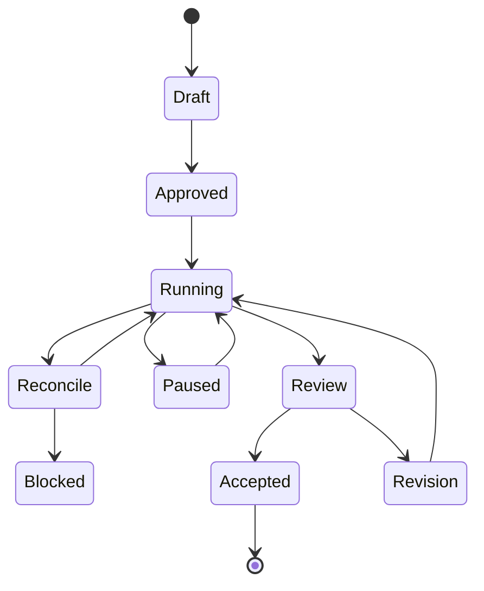

# Visual control and autonomy

Status: **Proposed**. This model governs [source synchronization](../03-subsystem-specs/007-visual-state-synchronization.md), [permissions](../03-subsystem-specs/011-extensibility-sandbox-and-permissions.md) and [recovery](../03-subsystem-specs/003-orchestration-and-recovery.md).

## Three interaction modes, one authority model

| Mode | Human interaction | Agent behavior | Shared invariant |
|---|---|---|---|
| Visual | Select, inspect, drag or edit supported properties | Optional explanation or assistance | Edits become source proposals |
| Hybrid | Describe intent, review previews and adjust a proposal | Generate bounded changes and explain evidence | Combined result is revalidated |
| Autonomous | Approve objective, scope, limits and checkpoints | Progress without an open canvas | Every effect passes host authorization |

The mode does not determine privilege. A visually initiated action can be high risk, while an autonomous task can be strictly read-only. Permission comes from the active grant and operation preconditions.

## Progressive workspace

The main workspace has a project selector, current objective, progress, preview and Changes panel. It defaults to the most useful artifact rather than a dense configuration dashboard. The Changes panel groups intent, source diff, semantic impact, evidence and restore point into one reviewable result.

Advanced details include model profile, tool versions, game/DLC context, budget, trace, dependency closure and fidelity limits. The user can open native source from a selected object. A preview failure keeps the source and task status accessible.

Autonomous tasks use the same status surface. The canvas may remain closed. Task notifications represent a blocker, completed review boundary or meaningful fault, not every internal step.

## Grant examples

A read grant permits source inspection and local validation against named roots. A proposal grant permits generating changes in an isolated task area. An apply grant permits named operation categories and path prefixes in a specified worktree under a change budget. A commit grant permits an owned branch commit after required checks. A merge or external publication requires the separate authority established by project policy.

A single reviewed task can include several of these categories. The product should reuse that existing authorization until expiry, revocation or a material scope change. Changing modes does not silently add capabilities. The default small focus task can authorize edit, validate and branch commit while reserving main-branch integration for review.

## Task lifecycle shown to the user

The durable engine also tracks attempts and leases, which stay in technical details unless they affect a user decision. A failed attempt does not imply the whole task failed. “Reconcile” means the system cannot yet determine whether an effect happened. It must not be displayed as safe to retry.

These diagram labels are presentation states, not an additional task enum. Draft maps to `planned`, Approved to `ready`, Running to `running`, Review to `in_review`, Accepted to `completed` and Blocked to `blocked`. Revision creates a new bounded attempt under the appropriate ready or running task. Paused is the durable scheduler pause condition, shown only after the active operation settles. Reconcile reflects an attempt in `reconciling` or `unknown_effect`. The authoritative task and attempt enums remain in [SPEC-003](../03-subsystem-specs/003-orchestration-and-recovery.md). Waiting for input and cancellation are additional technical states with their own user messages.

## Approval and review behavior

Review cards bind to an immutable proposal hash and show changed paths, semantic impact, relevant previews and exact validation coverage. Approval of a plan authorizes only its defined operation class and limits. Review of final source confirms a specific result. Both are attributable records.

A proposal changed after exact-result approval requires a new approval or a still-valid wider grant that expressly covers the change. The UI identifies which authority applies. Protected policy, credentials and approved canon are outside ordinary content-edit grants.

The user can pause or revoke in one clear action from the task surface. The host acknowledges the new authorization state before any further effect is dispatched. In-flight operations show their cancellation and reconciliation status.

## Reconciliation of human and agent edits

Each visual projection and task branch starts from a known source snapshot. External source changes invalidate affected projections. A pending gesture can be rebased only after conflict and preservation checks. A merge creates a new reviewable result and fresh evidence. Silent last-writer-wins behavior is unacceptable for scripts, identifiers and binary assets.

The first release supports this through worktrees, expected hashes and explicit conflict resolution. Real-time coediting is deferred. The user still has a useful collaborative workflow through native files and ordinary Git review.

## Fidelity and completion

A result can be source-complete and statically checked while game execution remains untested. A simulator can support a named fixture without proving all game states. Actual game evidence names the build, DLC and observed scenario. These are different kinds of evidence, not a single percentage score.

The default completion view states accepted objective, changed artifacts, checks performed, limitations and restore point. It never hides a known defect behind an attractive preview or equates an optional tool outage with a passing check.

