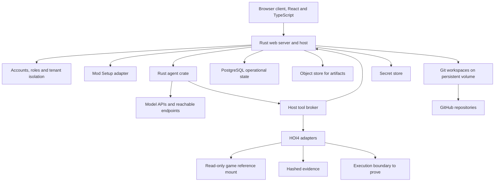

# Recommended architecture

Status: **Proposed, revised by [maintainer decisions of 2026-10-24](maintainer-decisions-2026-10-24.md)**, conditional on S01 evidence. The product is a public hosted web service. A Rust server owns integrity, a native Rust agent crate runs the model loop, a React and TypeScript client runs in the browser, and every mod remains an ordinary Git repository of native files.

## Components and responsibilities

The arrows show proposed responsibility boundaries. They do not imply every arrow is a separate network service. All server components ship as Docker images under [ADR-013](maintainer-decisions-2026-10-24.md#adr-013-docker-deployment).

The **browser client** presents intent, source, canvas, status and review. It receives projections over an authenticated session and submits typed requests. It never receives game files, provider keys, GitHub tokens or another tenant's data. It cannot make protected mutations directly. Every request is authorized by the server against the signed-in account and its project role.

The **Rust web server** is the host. It owns accounts, project membership, workspace identity, policy, source preconditions, Git operations, task transitions and recovery. It serializes write authority through leases and fencing tokens even when there is only one writer. Human collaborators and agents obtain the same leases, so an invited collaborator and an agent cannot silently overwrite each other.

The **accounts subsystem** implements sign-in through GitHub or email, per-account and per-project isolation, project roles for invited collaborators, quotas and abuse limits. Tenant isolation is a host invariant checked on every query and file path resolution, not a convention of the client. See REQ-046 and [SPEC-011](../03-subsystem-specs/011-extensibility-sandbox-and-permissions.md).

The **Setup adapter** reuses the inspected portable planning core on the server and adapts the existing desktop scanner and native transaction services to operate on server workspace paths. Launcher integration and the user's local Documents folder are out of scope. The facade maps existing plan and transaction states into C-09, preserves the resolved version manifest and passes C-01 into the workspace. It does not reimplement the importer. EXP-01 verifies this binding.

The **Rust agent crate** runs the model loop under [ADR-011](maintainer-decisions-2026-10-24.md#adr-011-native-rust-agent-runtime). It assembles provider streams, parses tool calls, classifies errors, accounts usage and honors cancellation. It holds no filesystem, Git, grant or tenant authority. It requests operations through the broker. Whether it runs inside the server process or in a supervised worker is measured in S01. Either placement keeps generation fencing, so a late result from a superseded run is rejected.

The **tool broker** validates final input and output schemas, authorization, tenant, roots, versions and receipts after every hook or repair. A tool catalog includes capability, effect class, cancellation support, timeout and evidence semantics. MCP is one adapter transport, not the source of authority. Broad shell and file tools are not exposed.

The **secret store** holds bring-your-own model keys, GitHub App installation tokens and operator credentials, encrypted at rest. Adapters receive a scoped secret reference for one request. Secrets never enter mod history, evidence, logs or client responses.

The **game reference mount** is a read-only full copy of Hearts of Iron IV, the latest build with all DLC, under [ADR-015](maintainer-decisions-2026-10-24.md#adr-015-server-held-game-reference). Validation, reference lookups, previews and asset resolution read it. It is never baked into images, exported, pushed or served as raw files. Evidence names the build and DLC set used.

The **execution boundary** represents containment work still to prove. Model-directed tools now run on shared infrastructure for many tenants. A container shares the host kernel and is not proof of isolation. The initial service permits only trusted bundled adapters with typed operations. Unreviewed executable extensions remain disabled. Per-task containers or a stronger sandbox runtime need EXP-07 evidence before public launch. **Game verification** is not run on the server. Actual game observations remain user-operated and are labeled as such.

The **state stores** separate authority by lifetime. PostgreSQL holds operational state, grants, events and receipts. Artifact bytes live in a content-addressed object store, either S3-compatible or a mounted volume behind one interface. Each mod lives in a Git repository on a persistent volume, optionally linked to GitHub. The [data model](data-context-and-state.md) explains how these stores reconcile without pretending they share one atomic commit.

## A complete focus task

1. The user signs in, then creates a mod through Setup, imports one from GitHub or uploads a ZIP. The server returns a validated workspace descriptor.
2. The user supplies intent and approves a bounded task scope.
3. The host creates an owned branch or worktree and source snapshot, then constructs a context bundle.
4. The agent crate proposes typed edits through the broker.
5. The host records the exact intent before an effect, checks current authority and tenant, and applies through the preservation adapter.
6. Static checks and a source preview run against the resulting bytes and the named game reference build. Evidence carries input and artifact hashes.
7. The browser presents semantic changes, raw diff, limitations and restore point. An authorized unattended task can reach the same result without opening the canvas.
8. The host commits only owned changes under the applicable grant. Push, pull request creation and default-branch integration on GitHub are separately authorized operations with reconciled receipts.
9. Recovery or restore uses the journal, receipts and recorded Git references. A lost response never authorizes blind replay.

## Why the product owns the hard boundaries

Inspected runtimes show why a library cannot be trusted with these invariants. Pi core can execute arguments changed by a hook without revalidating them. Its durable package permits replaying safe tools under a changed working directory. OpenCode's embedded host can repeat effects on restart and relies on ownership assumptions. These are recorded in [the candidate comparison](../00-research/03-candidate-comparison.md) and now serve as reference designs and counterexamples for the Rust crate, not as dependencies.

The factory therefore validates after all hooks, binds tool identity to tenant, workspace and source, and distinguishes safe repeatable reads from uncertain effects. A model's tool-call ID alone is insufficient. The narrow agent crate boundary keeps the loop replaceable without changing the mod's integrity rules.

## Durability boundary

The durable truth is the host's accepted state transition and receipt in PostgreSQL. Agent conversation state may help restart generation. It cannot declare a file apply, Git commit, push, pull request, upload or game action complete without the matching host evidence.

A single host incarnation owns a workspace write lease. A restarted server or worker increments its fencing token after proving prior ownership is no longer valid. Late results from an old worker cannot publish current state. Unknown process death or tool outcome becomes a reconciliation state. With several server replicas, lease acquisition goes through the database, not process memory.

## Onboarding compatibility

The audited Setup HEAD understands a newer manifest format than the audited Agentic source supplies. Agentic's inspected manifest selects HOI4 Agent Tools 4.0.3 while the separately audited tools release is 4.3.0. The handoff records the exact resolved closure. It must not silently upgrade tools merely because newer Setup code can represent them.

The audited Setup recovery CI failure is an explicit integration risk. Server workspaces make the failure no less serious. The architecture reuses Setup while requiring a verified pin and preservation fixture before production reliance. See [SPEC-001](../03-subsystem-specs/001-onboarding-and-mod-setup.md).

## Visual and source synchronization

A renderer produces an immutable projection from a source snapshot. A gesture produces a proposal against that snapshot. The same applies to an agent-generated edit or a collaborator's edit. The host rejects stale preconditions and generates a fresh preview after the final source change. Collaborators see an invalidated projection when another member or agent changes the source.

Use existing parsers for interpretation and validation where suitable. Use verified source-preserving operations for writes. A formatter or AST printer that regenerates the whole file cannot be assumed to preserve unknown syntax, comments or line endings. Unsupported visual edits stay disabled with source access available.

## Deployment and evolution

The first target is a public web service built from Docker images and portable across Linux hosts. No hosting provider is chosen. Development, self-hosting and production use the same images and Compose description. The [deployment and security](deployment-and-security.md) document covers images, tenancy, secrets and release gates.

Collaborators can be invited into a project from the first public release. Real-time co-editing of one file and distributed multi-writer agents still require an explicit later design. Download as ZIP, clone and push to the user's GitHub repository remain the supported escape hatch.

The architecture supports gradual expansion from focus editing to assets, localization, decisions, events and maps. Each adapter adds capability and fidelity declarations plus preservation and conflict tests. No subsystem can bypass the host because a larger workflow framework offers a convenient direct write API.
