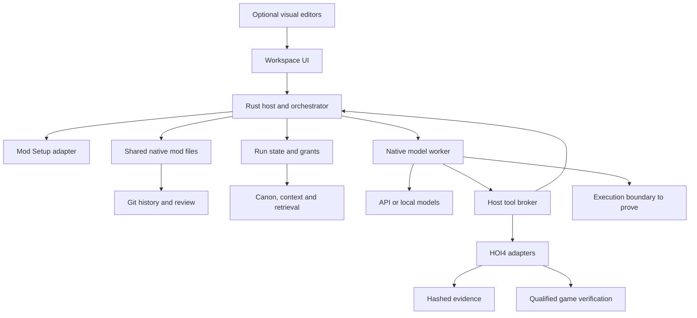

# Recommended architecture

Status: **Proposed Candidate A**, conditional on S01. The recommended product is a local-first desktop workspace with a native agent worker and an ordinary mod repository.

## Components and responsibilities

The arrows show proposed responsibility boundaries. They do not imply every operation is a network service.

The **workspace UI** presents intent, source, canvas, status and review. It receives projections and submits typed requests. It does not read arbitrary filesystem paths, hold provider secrets or make protected mutations directly.

The **Rust workspace host** owns workspace identity, policy, source preconditions, Git operations, task transitions and recovery. It serializes write authority through leases and fencing tokens even when there is only one worker. This establishes a safe extension point for later concurrency.

The **Setup adapter** reuses the inspected portable planning core and extracts or adapts the existing desktop scanner and native transaction services. Those services are outside the portable crate at the inspected revision. Its current callable desktop surface is typed Tauri commands. The proposed facade maps existing plan and transaction states into C-09, preserves the resolved version manifest and passes C-01 into the workspace. It does not invent a public HTTP API or reimplement the importer.

The **native model worker** embeds Pi libraries behind a small internal protocol. End users install the product package, not a coding CLI. The worker obtains only the context and short-lived credential access needed for the selected provider. It requests tool operations from the host. Broad default shell and file tools are not exposed merely because the underlying SDK supports them.

The **tool broker** validates final input and output schemas, authorization, roots, versions and receipts. A tool catalog includes capability, effect class, cancellation support, timeout and evidence semantics. MCP is one adapter transport, not the source of authority.

The **execution boundary** represents future containment work, not an existing guarantee supplied by a Node process or Tauri. The initial package permits trusted bundled adapters. Unreviewed executable extensions remain disabled. Reviewed third-party executable extensions require a demonstrated platform containment boundary. Any trusted-code exception is deferred to a separate reviewed decision with explicit risk and authority. **Game verification** is a separately qualified evidence producer. It may require a user-operated installed game because the audited native Live Tools runtime supports only a narrow Linux executable profile. A focus preview never routes through a game-verification label automatically.

The **state store** is a local transactional database. Artifact bytes live in a separate content-addressed store, and the mod stays in Git. The [data model](data-context-and-state.md) explains how these stores reconcile without pretending they share one atomic commit.

## A complete focus task

1. Setup inspects or creates a mod and returns its validated workspace descriptor.
2. The user supplies intent and approves a bounded task scope.
3. The host creates an owned worktree and source snapshot, then constructs a context bundle.
4. The model worker proposes typed edits through the broker.
5. The host records the exact intent before an effect, checks current authority and applies through the preservation adapter.
6. Static checks and a source preview run against the resulting bytes. Evidence carries input and artifact hashes.
7. The UI presents semantic changes, raw diff, limitations and restore point. An authorized unattended task can reach the same result without opening the canvas.
8. The host commits only owned changes under the applicable grant. Shared integration follows the project's review policy.
9. Recovery or restore uses the journal, receipts and recorded Git references. A lost response never authorizes blind replay.

## Why the product owns the hard boundaries

The current Pi core can execute arguments changed by a hook without revalidating them in that path. Its durable package has stronger checks, yet upstream recovery tests intentionally permit replaying safe tools under a changed working directory. OpenCode's current embedded host is real, but its restart behavior can repeat effects and relies on ownership assumptions. These source findings are detailed in [the candidate comparison](../00-research/03-candidate-comparison.md).

The factory therefore validates after all hooks, binds tool identity to workspace and source, and distinguishes safe repeatable reads from uncertain effects. A model's tool-call ID alone is insufficient. The decision preserves flexibility to replace Pi with OpenCode or OpenHands without changing the mod's integrity rules.

## Durability boundary

The durable truth is the host's accepted state transition and receipt. Runtime conversation persistence may help restart generation. It cannot declare a file apply, Git commit, upload or game action complete without the matching host evidence.

If `pi-durable` is selected, S01 must specify exactly which records it owns and how they correspond to host attempt IDs. Prefer an adapter that treats its session journal as subordinate. A runtime event can request or report work, while the host determines whether the authoritative effect settled. Avoid independently resuming both databases.

A single host incarnation owns a workspace write lease. A restarted process increments its fencing token after proving prior ownership is no longer valid. Late results from an old worker cannot publish current state. Unknown process death or tool outcome becomes a reconciliation state.

## Onboarding compatibility

The audited Setup HEAD understands a newer manifest format than the audited Agentic source supplies. Agentic's inspected manifest selects HOI4 Agent Tools 4.0.3 while the separately audited tools release is 4.3.0. The handoff records the exact resolved closure. It must not silently upgrade tools or expose client integrations merely because newer Setup code can represent them.

The audited Setup recovery CI failure is an explicit integration risk. The architecture reuses Setup while requiring a verified pin and preservation fixture before production reliance. See [SPEC-001](../03-subsystem-specs/001-onboarding-and-mod-setup.md).

## Visual and source synchronization

A renderer produces an immutable projection from a source snapshot. A gesture produces a proposal against that snapshot. The same applies to an agent-generated edit. The host rejects stale preconditions and generates a fresh preview after the final source change.

Use existing parsers for interpretation and validation where suitable. Use verified source-preserving operations for writes. A formatter or AST printer that regenerates the whole file cannot be assumed to preserve unknown syntax, comments or line endings. Unsupported visual edits stay disabled with source access available.

## Deployment and evolution

The first target is a desktop maintainer workspace with local files and an optional local model endpoint. Windows is the initial candidate platform because the user's source workflow has substantial Windows integration. This is a proposal, not a claim about the user's installed system. Linux and macOS require their own packaging and recovery fixtures before support is advertised.

A hosted coordination service can later share tasks and redacted review artifacts. It must not require uploading game installations or all private project content. Real-time coediting, multiple writers and distributed leases require an explicit later design. The local native file workflow remains a supported escape hatch.

The architecture supports gradual expansion from focus editing to assets, localization, decisions, events and maps. Each adapter adds capability and fidelity declarations plus preservation and conflict tests. No subsystem can bypass the host because a larger workflow framework offers a convenient direct write API.

