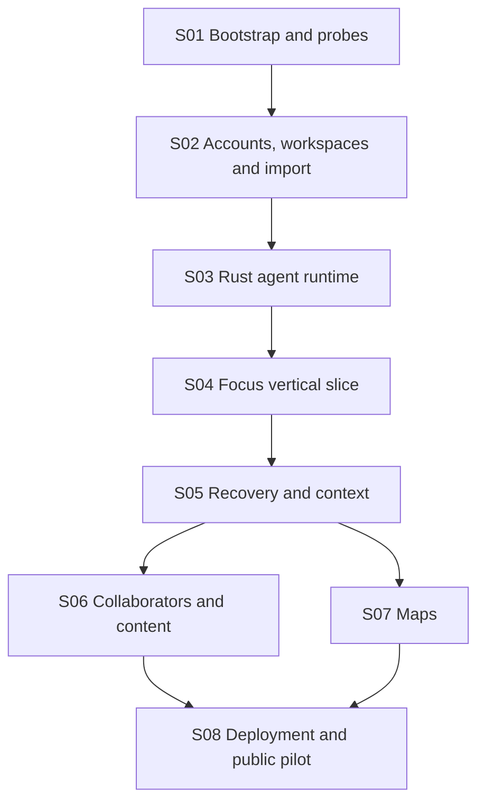

# Implementation roadmap

Status: **In implementation**. S01 to S03 are complete. The UI design track is next, then S04. Each stage still needs its own authorization. [MASTER_GOAL](../MASTER_GOAL.md) defines the product, the [maintainer decisions](../02-architecture/maintainer-decisions-2026-10-24.md) of 2026-10-24 set the hosted web, Rust runtime, Docker, GitHub and licensing direction, and each stage below defines a separately reviewable unit of work.

On 2026-11-01 the maintainer asked for every stage plan to be updated at once, so the whole path is planned before the next authorization. The stage files now say how each stage uses the shared Rust engine, the visual editors with two-way editing (FR-5), the narrowed Hagane harvest (A1, A1-1), the MCP tools and the tool quality bar (Q-1). The cross-stage plan is in [engine, editors and tools across stages](#engine-editors-and-tools-across-stages). This update authorizes no stage.

## Dependency order and release checkpoints

| Stage | Reviewable capability | Entry dependency | Release significance |
|---|---|---|---|
| [S01](stage-01-bootstrap-and-probes.md) | Claude-first workspace, verified config migration, Cargo and Compose skeleton, evidence from Setup on server paths, preservation, Rust runtime, container and GitHub probes | Explicit authorization for S01 | Architecture confirmation, not a product release |
| [S02](stage-02-onboarding-and-workspaces.md) | Accounts with GitHub and email sign-in, per-account server workspaces, reused new/import setup, upload and GitHub import, read-only game reference | S01 decision receipt and cleared preservation risk for the selected pin | Foundation usable by later stages |
| [S03](stage-03-native-agent-and-durability.md) | Native Rust agent loop, durable attempts, scoped tools, interruption, truthful capability profiles, user keys and operator allowance metering, one MCP tool profile shared with coding clients, Q-1 benchmark baseline | S02 | Native task substrate |
| [S04](stage-04-focus-vertical-slice.md) | Small real focus change in the browser through visual, hybrid or autonomous modes, with review, commit, GitHub pull request and restore. Two-way focus editor, engine library linked, reference closure before every agent commit, import preservation report | S03, the UI design track, agent-tools W3 and the first engine route moves | First useful demonstration |
| [S05](stage-05-context-and-recovery-hardening.md) | Cross-session and cross-model continuity, freshness, approved canon and reviewed runtime lessons. Human and coding-client edits stay visible to the next agent session, rules lookup measured | S04 | Required before any pilot |
| [S06](stage-06-collaboration-and-content.md) | Invited collaborators with project roles, dependency tasks, localization and assets, controlled concurrency. Event, decision, character and idea editors, localisation tool for every language, GFX checks, Hagane export import | S05 | Required for the first public release |
| [S07](stage-07-maps-and-structured-import.md) | Map inspection, bounded structured import and one supported source-preserving edit. Two-way map, technology and GUI editors | S05, plus S06 only for reused content facilities | Expanded map scope, deferrable by review |
| [S08](stage-08-packaging-and-pilot.md) | Docker deployment on staging, tenant and security validation, backup and upgrade, provider comparison, rights and license gate, observed pilot, published Q-1 head-to-head result | S04, S05, S06, and S07 unless explicitly deferred | Reviewable public release decision |

**UI design track (ADR-025).** Between S03 and S04, a separate interactive session redesigns the browser client. The maintainer picks each page's design from working variants in a development-only design lab. It is not a numbered stage and has no exit gates beyond the maintainer's choices and passing client checks. Its goal prompt is [GOAL-UI](../06-agent-handoffs/GOAL-UI.md). Later stages use the resulting design system and send new pages through the same loop.

Every stage contains six work packets with conceptual owners, deliverables, dependencies, explicit non-goals and evidence gates. There are 48 packets in this baseline. Owners describe responsibilities. They are not a prescription to run 48 agents.

## Smallest credible product

The first useful demonstration is S04. Start with a small three-to-five-focus branch, one supported source profile, an owned branch in a server workspace and a bounded model task. Create one fresh mod and import one established synthetic fixture from a disposable GitHub repository through reused Mod Setup. Run a native model call, generate and approve a plan, apply a supported change, inspect source and visual evidence in the browser, commit owned changes, push the branch and open a pull request under a separate grant, then restore or continue externally.

The visual-first path includes a supported direct node or scalar edit. The hybrid path combines a prompt and a human adjustment. The autonomous path completes with the browser closed. They use the same source preconditions, grants, evidence and history. “Equivalent” means equivalent accepted semantics and preservation, not identical generated prose or pixel positions.

S04 is not enough for a public release. S05 supplies stronger model handoff, context, stale-evidence and long-sequence recovery guarantees. S06 supplies invited collaborators, which the maintainer requires in the first public release. S08 supplies deployment, tenant isolation, backup, security, rights review, support claims and pilot evidence. A reviewed release may defer S07, but it must explicitly exclude map capabilities and still pass applicable S08 gates. This is a scope decision, not a skipped test disguised as success.

## Reuse and integration milestones

S01 resolves the observed Setup recovery failure on server workspace paths, establishes the usable parser subset inside the Linux image and measures the open Rust runtime questions before selecting pins. S02 adapts Setup's existing desktop scanner and transaction services to server paths alongside its portable core. The current Tauri commands are inspected interfaces only. A reusable Rust facade is proposed work.

S03 connects the Rust agent loop to host-owned contracts C-01 through C-10, including C-10 RepositoryLink for GitHub operations and reconciliation. The Rust server owns grants and effects. S04 proves that native files, browser projections, autonomous work and GitHub publication converge through that authority. S05 proves that source and task truth survive replacement of the model and the chat.

S06 adds human collaborators and agent concurrency only after single-writer evidence exists. S07 starts with existing structured files and bounded edits because the audited geography-model synthesis path is unavailable. Neither a renderer nor a reference-image generator supplies missing playable-world generation.

## Engine, editors and tools across stages

S03 was complete before this plan was written, so the tool profile, engine client and first Q-1 baseline it first assigned to S03 are S04 entry work (S04 gates 11 and 12).

This section is the cross-stage plan written on 2026-11-01. It follows ADR-028 (D-07, A1, A1-1, FR-5 and Q-1) and the [expansion roadmap](../08-expansion-research/09-implementation-roadmap.md). Work in hoi4-agent-tools, HOI4 Mod Setup and `hoi4-imagegen-mcp` happens there, through feature branches and pull requests, and a stage depends on its merged and released result. Nothing here is built yet unless it says so.

### Shared Rust engine

The engine (W4) is a Cargo workspace inside hoi4-agent-tools under Apache-2.0: `hoi4-syntax`, `hoi4-engine`, `hoi4-drawio` and `hoi4-engine-cli`. W4 is merged in agent-tools. Its own ADR 0074 plans the route moves. No MCP tool calls the engine yet.

| Step | Where | Needed by | Done when |
|---|---|---|---|
| Per-platform binaries: Windows x64, macOS arm64, Linux x64 and arm64 as optional npm packages with checksums. Docker images build the engine from pinned source | agent-tools release workflow | S04 entry (pinned in the server image and in the coding-client profile) | A release carries all four binaries and the server image digest names the engine revision |
| Core engine client: JSON request, schema-checked response, the engine reported as unavailable instead of a silent fallback to TypeScript | agent-tools `core` | S04 entry | A missing or broken binary makes the tool return an explicit unavailable result |
| `hoi4.mod_index` on the engine (definition counts, `next_id`) | agent-tools | S04 entry | The existing route tests pass unchanged against the engine |
| `hoi4.source_lookup` on the engine's symbol index (M-8) | agent-tools | S04 entry | The existing route tests pass unchanged against the engine |
| Whole-mod closure as an option of `hoi4.script_validate` | agent-tools | S04 entry | Resolved, unresolved and unknown counts per kind, verdict `incomplete` whenever anything is unknown |
| Engine linked into the server as a library | HOI4 Factory S04 | S04 | Closure, lints, override audit and findings baseline (P1 to P4) run in the server before every agent commit |
| Map hot paths, then the remaining analyzers (M-8) | agent-tools | S05 to S07 | Each moved route keeps its tests and is faster on the M-6 benchmark mods |
| Focus routes on the engine after W3 and W7 settle | agent-tools | S04 if ready, otherwise S05 | Focus tool tests pass unchanged, and the server and the MCP read one layout model |
| Event, decision, character and idea routes on the engine | agent-tools | S06 | Each new writer is built on the engine's span edits, not on the TypeScript index |
| TypeScript index retired | agent-tools | Target S06 exit, checked in S08 | No route reads the TypeScript index, or S08 lists the remaining route as an accepted limitation |

The move order follows M-8 and is work package WP-5 of the [MCP improvement plan](../08-expansion-research/12-mcp-improvement-plan.md): binaries, the symbol index (`mod_index`, then `source_lookup`), the whole-mod reference report in `script_validate`, the map hot paths, the remaining analyzers, then retiring the TypeScript index. The ZIN MCP worker owns that sequence in agent-tools. The two indexes must not disagree while both exist. ADR 0074 records one known difference: the TypeScript scanner treats `replace_path` as covering subfolders and the engine does not. Until a route moves, a server check that relies on load order uses the engine and labels the MCP answer it differs from.

**Reference closure before every agent commit (S04 onward).** The server runs the linked engine on the proposal's worktree before an agent commit. A new finding at or above the project threshold blocks the commit and returns the finding to the agent. Existing findings recorded in the baseline do not block. Unknown references never count as a pass, and the review card shows their count. Repair plans from the engine become ordinary C-02 proposals, refused when the source hash changed.

**Import preservation report (P4).** S04 adds it to the Setup import flow for uploads and GitHub imports: one row per path saying parsed, kept byte-exact or not understood, the findings that already existed and the recorded baseline. S06 extends it to Hagane Studio export ZIPs.

### Visual editors with two-way editing (FR-5)

Every editor is the MCP read and render tools shown to people, with the same write operations the agent uses. There is one operation layer and no editor-only write path. The pattern, specified in [contracts](../02-architecture/contracts-and-interfaces.md#shared-editing-operations-and-the-engine):

1. **Projection.** The server calls the same inspect tool the agent calls, from the pinned tool profile, and binds the result to file hashes. The canvas draws from inspect data. Render images are used for review cards and for the agent.
2. **A person's edit.** A drag, snap, link or field edit becomes the same rewrite request the agent would send, with the same arguments and expected hashes, as a C-02 proposal whose actor is the person. In the visual editing style it applies at once under the person's grant to their owned branch.
3. **Live state both ways.** Every applied change emits a C-03 `source_changed` event with the changed IDs and new hashes. Open editors refresh from inspect. The agent's next tool result names what changed since its last read, so it re-inspects and continues instead of overwriting. A stale agent rewrite is refused with `stale_base` and the current hashes.
4. **An agent's edit.** It takes the same path. A pending proposal shows on the canvas with apply or discard per node, and an applied change redraws without a reload.
5. **Parity tests.** For each supported operation, one fixture runs the gesture path, the native agent tool call and a direct MCP call from a coding client against a clone. File bytes, the projection and the finding delta must be identical (T-EDIT-01).

| Editor | Stage | Read and render tools | Write today | Writer work in agent-tools |
|---|---|---|---|---|
| Focus | S04 | `hoi4.focus_inspect`, `hoi4.focus_render` (W3 verdict, connector model, inline renders), `hoi4.mod_index`, `hoi4.reference_search`, `hoi4.source_lookup` | `hoi4.focus_rewrite` within the EXP-02 subset | W7 layout solver for snapping (lanes with `relative_position_id` anchors, corridor insertion keeping untouched coordinates, shared geometry, `offset` blocks) |
| Event | S06 | `hoi4.event_inspect`, `hoi4.event_render`, `hoi4.probability_inspect`, `hoi4.probability_analyze`, `hoi4.impact_inspect`, `hoi4.scenario_test` | None, read-only | An event writer on the engine's span edits |
| Decision | S06 | `hoi4.decision_inspect`, `hoi4.impact_inspect`, `hoi4.mechanic_test` | None, read-only | A decision writer |
| Character | S06 | None. `hoi4.source_lookup` and the reference tools only | None | Character inspect, render and rewrite tools |
| Idea | S06 | None. `hoi4.source_lookup` and the reference tools only | None | Idea inspect, render and rewrite tools |
| Technology | S07 | `hoi4.tech_inspect`, `hoi4.tech_render` | None, read-only | A technology writer reusing the focus grid geometry |
| GUI | S07 | `hoi4.gui_inspect`, `hoi4.gui_render` | `hoi4.gui_rewrite` | Parity tests only |
| Map | S07 | `hoi4.map_inspect` | `hoi4.map_rewrite` | The bounded operation S07-W3 selects |

**Game preview (D-16).** Every visual editor, from the focus editor in S04 onwards, includes an in-app game preview: a fast, faithful rendering of how the mod content looks in the game, built on the hoi4-agent-tools renderers (`hoi4.focus_render` in S04, then `hoi4.event_render`, `hoi4.tech_render`, `hoi4.gui_render` and the map renders in the stages of their editors). It must be far faster and more reliable than Hagane Works' preview, measured on the same content as part of Q-1. It complements in-game checks and never replaces them: real in-game testing is done through the HOI4 Live Tools MCP where it is set up, otherwise by a human, for example on the web version (D-15). The hands-on review of Hagane Works v0.1.3 proposed nine preview targets, which the maintainer decides:

1. A warm preview update after an edit within 1 s, and never slower than Hagane's 2 to 3 s on a loaded machine.
2. A cold first preview faster than Hagane's base layer (90 CPU-s, about 5 min in the review), with no idle eviction that forces a full rebuild.
3. A 1,000-focus tree that stays interactive, with zoom and hover.
4. Every localisation key the game resolves is resolved (Hagane missed 527 of 550 event titles in Ireland Total Overhaul).
5. Art the mod defines is drawn: event pictures, idea pictures and scripted GUI art.
6. Visibility is evaluated, so a screen shows only what the player would see, for example decisions.
7. Every DDS format the base game uses is decoded, including DX10-header files (hoi4-agent-tools #76).
8. Missing text shows as the raw key, like the game, and every missing or undecodable asset is reported.
9. Saving or exporting never changes files the user did not edit.

Today the agent-tools renders take 20 to 155 s per call (#74), and `focus_render` is a schematic rather than game-like (#75).

**Hagane failures as test cases.** The Q-1 and D-16 fixtures include the failures the review found, so our tools prove they beat them: raw keys shown for 527 of 550 event titles and descriptions although the mod defines them, silent empty renders for undefined sprites, missing textures and DX10 or BC7 textures, and an export whose merge loses 59 percent of comment lines and all 113 idea `picture =` lines. Each is a regression test that must pass on our side.

Every editor also calls the shared checks: `hoi4.script_validate` with the closure option, `hoi4.package_check` and the engine's finding delta. `hoi4.error_log` reads logs the user uploads. New tool names are proposals until their agent-tools pull request fixes them. The client screens for each editor go through the ADR-025 design track. None of Hagane Studio's visual design is reused.

### Hagane harvest (A1, A1-1)

Only hard capabilities are taken, each adapted to this architecture, and each must end up better than the original (Q-1). Much of the engine-side harvest already landed in agent-tools W4, listed in its `engine/PROVENANCE.md`.

| Capability | Lives in | State on 2026-11-01 | HOI4 Factory stage | Acceptance |
|---|---|---|---|---|
| Hash-guarded span repair plan | Engine `repair.rs` | Landed in W4 | S04 | A plan becomes a C-02 proposal. A changed source hash or a deletion under boolean logic is refused |
| Per-edit finding delta | Engine `delta.rs` | Landed in W4 | S04 | The review card shows introduced, worsened, changed, improved, unchanged and resolved findings for every proposal |
| Dead-flag and DLC lints | Engine `lints.rs` | Landed in W4, rewritten per A1-3 | S04 | Each rule checks the whole mod (achievements, scripted effects and triggers, mod `.gfx`), never changes output and stays within a time budget. Valid and invalid fixtures per rule, zero false alarms on vanilla, DLC names from the project's game reference |
| Finding-code catalog as fixtures | Engine tests | Landed in W4 | S04 entry (benchmark fixtures) | The code names seed our catalog only. Each mapped code has an engine fixture, and the Q-1 validation surface runs them against Hagane Studio |
| draw.io sketch importer | Engine `hoi4-drawio` | Landed in W4, fixes needed (A1-3) | S06 | Deflate-compressed diagrams, OR groups and mutual exclusion are supported. A sketch imports into a new focus branch as a proposal, and the Hagane parity fixture passes |
| Focus graph wiring on xyflow | Hagane Studio client | Not taken | S04 decision | Taken only if the S04 design shows it saves real effort. The decision and its reason are recorded in S04 evidence |
| Hagane export ZIP import | HOI4 Factory import flow | Not started | S06 | A Hagane export imports with a preservation report that recognizes Hagane conventions without adopting them. Test exports are generated by running Hagane Studio locally from its GPL source in `hagane-works/hagane-studio`, which holds the exporter, and no sample exports are requested |
| Game discovery | Local companion, rewritten in Rust | Not started | Companion stage proposal after S06 | Validity is checked with `launcher-settings.json` or the game executable, not only four folders. Tests on Windows and macOS |
| Safe mod install | Local companion, rewritten in Rust | Not started | Companion stage proposal after S06 | The ownership marker and the refusal of folders owned by another mod are kept, with no forced acknowledgement of blockers. Its own security review |
| Log parsing | Local companion, rewritten in Rust | Not started | Companion stage proposal after S06 | Its own test before harvest |
| Event and decision preview cards | None | Dropped | None | Our render tools cover them |
| Mutation receipts, edit revisions, duplicate-ID refusal | HOI4 Factory operations, agent-tools rewrite tools | Pattern adopted (A1-3) | S04 | Every write returns a receipt and refuses a duplicate ID, and a test shows a write changes only the fields it names |
| Game preview renderer | None, ideas only | Code not ported (A1-3) | S04 onward (D-16) | Our renderers gain a resident cached base layer, bitmap-font glyphs, window navigation and whole-screen context (hoi4-agent-tools #74, #75, #76) |
| Export, Loaded-mode merge, session model | None | Not harvested (A1-3) | None | Our Git-native model keeps unedited bytes, and every local route needs a secret |

**Archiving Hagane Studio (W8).** The studio is archived when HOI4 Factory imports a Hagane export with a preservation report (S06), the companion syncs local mod folders (the companion stage) and the focus (S04), event, decision and character editors (S06) exist. W8 is blocked until the maintainer controls the repository.

### Tool quality bar (Q-1)

HOI4 Factory and hoi4-agent-tools must be measurably ahead of `cpntodd/HOI4-MCP` and Hagane Studio. The proof is a head-to-head benchmark (T-BENCH-01) on shared mod files and questions. Under M-7, `cpntodd/HOI4-MCP` is measured once, in an isolated container with a pinned commit, read-only mod copies and no network, and none of its code is copied. After that, CI benchmarks measure against our own stored baselines. The benchmark mods are the M-6 set.

| Surface | Tools | Measure | Target |
|---|---|---|---|
| Rules and reference lookup | `hoi4.reference_search`, `hoi4.reference_read`, `hoi4.reference_context`, `hoi4.source_lookup` | Rank of the right answer on the blind question set, checked against a human answer key | First on at least 22 of 24 blind questions and in the top three on all 24. Exact names always first, negative queries return nothing ([MCP improvement plan](../08-expansion-research/12-mcp-improvement-plan.md#targets)) |
| Validation | `hoi4.script_validate`, engine check, `hoi4.package_check` | False errors on vanilla and on the known-good files of the benchmark mods, seeded defects caught | No false errors on vanilla or the known-good files of the benchmark mods, and every seeded defect class caught ([MCP improvement plan](../08-expansion-research/12-mcp-improvement-plan.md#targets)) |
| Honest unknowns | Engine closure, inspect tools | Share of unresolvable references reported as unknown | All of them, never a pass |
| Recurring errors (M-3) | `hoi4.error_log` | Repeated errors across launches grouped into signatures and linked to documentation or an approved rule | Every signature in the fixture logs grouped and linked |
| Latency | Inspect, lookup, validate and rewrite tools | Wall time on declared hardware for fixed fixtures | Warm lookup p95 at most 50 ms. Cold `hoi4.mod_index` at most 2 s and first `hoi4.source_lookup` at most 3 s on Chaos Redux. The plan's other targets apply too ([MCP improvement plan](../08-expansion-research/12-mcp-improvement-plan.md#targets)) |
| Editor round trip | HOI4 Factory editors | Gesture to saved file and agent-visible state, agent edit to redraw | 1 s p95, with Hagane Studio measured on the same tree |

Q-1 uses absolute targets that prove a clear lead, not parity with rivals (Q-1a). The MCP targets are the ones in the MCP improvement plan, and the editor round trip stays a planning default that the S04 entry baseline confirms. From S04 on, every stage's exit gates include no regression on this benchmark: a result worse than the stored baseline beyond measured noise fails CI, and the baseline moves only on an improvement or a recorded maintainer decision. The MCP surfaces run in hoi4-agent-tools CI. The editor surfaces run in HOI4 Factory CI on the same pinned fixture set. Vanilla runs need a licensed game copy, so they run on a runner that holds one and never publish game files. Hosted CI runs the synthetic and public-mod parts.

The rules-lookup measurement under way in a separate session feeds this benchmark's lookup surface and S05's retrieval baseline (EXP-05). If it lands before S04, S04 uses its improved tools. The [MCP improvement plan](../08-expansion-research/12-mcp-improvement-plan.md) holds the HOI4-MCP comparison, the live-test findings, per-surface targets and the agent-tools work packages WP-1 to WP-9 that deliver them.

### Coverage gaps in hoi4-agent-tools

The agent-tools side of these gaps is work package WP-8 of the [MCP improvement plan](../08-expansion-research/12-mcp-improvement-plan.md).

| Gap today | Plan | Stage |
|---|---|---|
| No localisation tool | Localisation inspect and rewrite tools on the engine's localisation reader | S06 (S06-W3) |
| Only English localisation indexed | Index every language folder, with coverage per language | S06 (S06-W3) |
| No tools for ideas and characters | Inspect, render and rewrite tools | S06 (S06-W4) |
| Event and decision tools are read-only | Writers on the engine's span edits | S06 (S06-W4) |
| Technology tools are read-only | A writer | S07 (S07-W3) |
| No GFX asset validation | Sprite and `.gfx` registration checks in the engine, DDS header and profile checks through `hoi4-imagegen-mcp` | S06 (S06-W3) |
| No tools for on_actions, MIOs, balance of power, special projects, operations and raids | Inspect tools, then render and rewrite where they help (M-9, third group) | agent-tools after S06's localisation, idea and character tools. HOI4 Factory editors stay in the [backlog](BACKLOG-AND-DEFERRED-SCOPE.md) |
| No sound validation | Sound validation with GFX validation (M-9, fourth group). S06 tracks audio as assets with provenance | agent-tools after the third group. Editors are in the backlog |
| No units, division templates, OOB or equipment tools | Inspect tools first (M-9, fourth group) | agent-tools after the third group. Editors are in the backlog |
| No CI on real vanilla | A vanilla job on a runner with a licensed game copy | S04 entry, before the Q-1 baseline |
| No macOS Node CI job | A macOS arm64 job in agent-tools Node CI (M-13) | S04 entry, before per-platform binaries are trusted |

### MCP improvement decisions (M-1 to M-15)

The maintainer's MCP decisions of 2026-11-01 are recorded in the [expansion decision record](../08-expansion-research/00-decision-record.md). They are hoi4-agent-tools work unless the table says otherwise, delivered through the work packages of the [MCP improvement plan](../08-expansion-research/12-mcp-improvement-plan.md).

| Decision | Lands in | HOI4 Factory stage that relies on it | Done when |
|---|---|---|---|
| M-1 skills served by the MCP | `hoi4.skill` tool and MCP resources | S04 entry (one tool profile), S05 (the native loop reads the same pinned skills) | The served text matches the pinned kit version and hash, and a drift check fails otherwise |
| M-2 approved rules at kit and mod level | Kit and mod repositories, served by the MCP | S05 (rules in the context bundle), S06 (mod rules per project) | A proposed rule takes effect only after approval and carries reason, evidence and a regression test. `LESSONS.md` is converted |
| M-3 recurring error signatures | `hoi4.error_log` | S06 (log upload review), the companion stage | Fixture logs from several launches group into counted signatures linked to documentation and rules |
| M-4 no redundant guards, drift guards kept | All rewrite tools | S04 onward (FR-5 concurrency) | No edit-size guard or similar is added. The stale-base refusal and expected hashes stay and are covered by T-EDIT-01 |
| M-5 generated tool documentation | agent-tools docs and CI | S04 entry (pinned tool profile) | Docs are generated from the definitions, and CI fails on drift, duplicates or an undocumented tool |
| M-6 benchmark mods | T-BENCH-01 fixture set | S04 entry baseline, every later exit gate | Vanilla, Chaos Redux, ZIN, Ireland Total Overhaul and two or three large Workshop mods pinned at fixed versions, run locally |
| M-7 HOI4-MCP measured once | Isolated container run | S04 entry baseline | One recorded head-to-head result. Later runs compare with our own baselines |
| M-8 Rust move order | Engine route moves | S04 to S08, see the engine table above | The TypeScript index is retired |
| M-9 coverage order | New inspect, render and rewrite tools | S06 (localisation, ideas, characters), S07 and the backlog (the later groups) | Each area has inspect, and render or rewrite where they help, with tests on the M-6 mods |
| M-10 lookup vocabulary | Reference lookup tools | S05 (retrieval baseline EXP-05) | Vocabulary built from game localisation plus a short hand-checked list. An optional local embedding layer, pinned by hash and fetched only when switched on, is kept only if it clearly beats word ranking on an untouched blind test set without hurting exact-name or negative queries. Word ranking stays the fallback |
| M-11 writers with their editors | Event, decision and technology rewrite tools | S06 (event, decision), S07 (technology) | Each writer ships with its editor and passes T-EDIT-01 |
| M-12 nightly real-game benchmark | A maintainer machine with the game | Every exit gate from S04 | Nightly results are stored locally with hashes, and a regression is flagged |
| M-13 macOS arm64 CI | agent-tools Node CI | S04 entry | The job runs on every pull request |
| M-14 Chaos Redux tools in a private plugin | agent-tools plugin loading | S04 entry (public tool profile) | The public package has no `chaosx.*` tools, and the server loads the plugin only when it is present |
| M-15 HOI4-MCP licensing | None | None | No action |

### Coding-agent integration

The native Rust loop, Claude Code and Codex use the same tools and operations, so agents and people work on one state.

- **One tool profile.** The server pins one hoi4-agent-tools release with its engine, and `hoi4-imagegen-mcp` from S06. The native loop calls them through the broker. HOI4 Mod Setup installs the same pinned versions and the kit for a local Claude Code or Codex session on a clone. Tool names, arguments and results are the same in both places.
- **Local coding clients.** A person or a coding agent working on a clone pushes to GitHub. The server detects the external change (S04-G6), re-validates it with its own pinned tools and records the client's tool version in the evidence. S05 makes that change visible to the next native agent session.
- **Same knowledge.** The native loop loads the kit's skills and approved rules as versioned product knowledge (A4), served by `hoi4.skill` and the MCP resources (M-1, M-2), the same text a local coding client reads.
- **Hosted access for external agents.** A product MCP endpoint that lets an external coding agent work on the hosted workspace through the same proposals and grants stays in the [backlog](BACKLOG-AND-DEFERRED-SCOPE.md), read-only first.
- **Parity.** T-EDIT-01 includes the coding-client path, so a gesture, a native agent call and a local MCP call produce the same bytes.

## Parallel work without split authority

Within S01, Setup, source-fidelity and runtime probes may run independently after the environment and guidance are established. Their owners must use separate disposable fixtures and return evidence to one decision owner.

Within later stages, browser projections, deterministic fixtures and documentation can be developed in parallel against a frozen contract. Operations that alter the shared host journal, grant semantics, account isolation, parser API or Git and GitHub publication path require coordinated ownership and integration before acceptance. Never merge two competing authoritative implementations of the same contract.

After S05, S06 and S07 may progress in parallel when they have separate modules and source fixtures. A map packet that depends on shared asset provenance or review code waits for that specific S06 packet. S08 pilot execution waits for a frozen advertised capability set.

## Gate semantics

A stage is complete only when every mandatory exit gate has a result against its final revision. A known source-loss, cross-account or unauthorized-write failure blocks the affected capability. Missing credentials, hardware, a GitHub test repository or an in-game check (done through the HOI4 Live Tools MCP where it is set up, otherwise by a human, D-15) produce an explicit unavailable result. They do not count as a pass.

The [acceptance matrix](../05-verification/REQUIREMENTS-ACCEPTANCE-MATRIX.md) maps all 50 requirements and all 59 stage gates to planned checks. Twelve gates were added on 2026-11-01 for the engine, the editors, imports and Q-1. The [evaluation matrix](../05-verification/EVALUATION-MATRIX.md) defines model tasks and measurement. Stage evidence uses the six-file handoff convention in [the handoff template](../06-agent-handoffs/STAGE-HANDOFF-TEMPLATE.md).

Review a stage's actual result before authorizing the next. The future agent reports a concrete next-stage scope and stops. No handoff grants automatic progression.

## Effort and uncertainty

No calendar or person-day estimate is claimed. The dominant uncertainties are source-preserving adapter coverage, recovery correctness, the maintenance cost of a project-owned Rust agent loop, tenant isolation and containment of model-directed tools on shared servers, and operating cost of a free public service. S01 turns the technical ones into bounded experiments. The rights review and hosting choice are maintainer decisions recorded in S08.

Use [the backlog](BACKLOG-AND-DEFERRED-SCOPE.md) to preserve aspirations without inflating the first slice. Every substantive packet, debugging fix and stage concludes with the learning and configuration reviews. A justified no-change outcome is valid.
