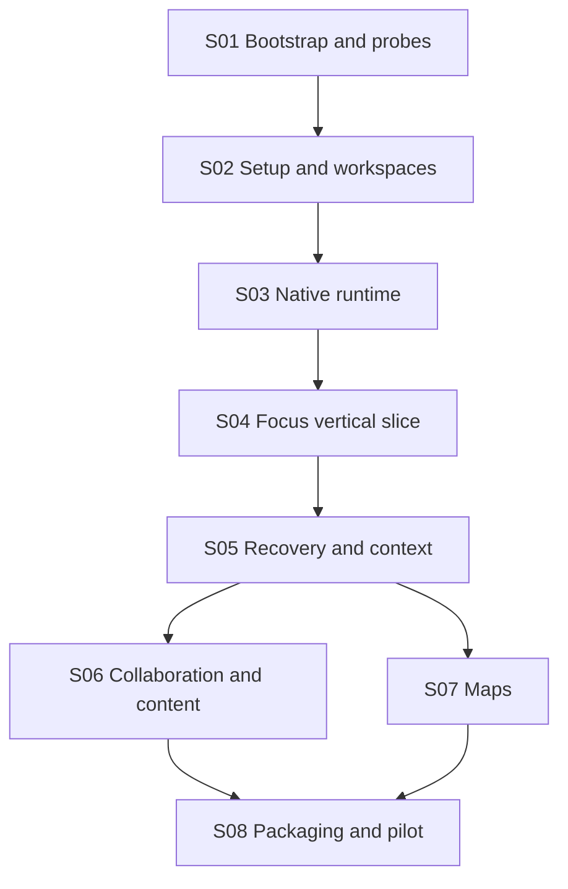

# Implementation roadmap

Status: **Proposed, awaiting review and bounded stage authorization**. This package completes planning. It does not authorize product implementation. [MASTER_GOAL](../MASTER_GOAL.md) defines the product, while each stage below defines a separately reviewable unit of work.

## Dependency order and release checkpoints

| Stage | Reviewable capability | Entry dependency | Release significance |
|---|---|---|---|
| [S01](stage-01-bootstrap-and-probes.md) | Claude-first workspace, verified config migration, evidence from Setup, preservation, runtime and packaging probes | Explicit authorization for S01 | Architecture choice, not a product release |
| [S02](stage-02-onboarding-and-workspaces.md) | Reused new/import setup produces an authoritative workspace and recoverable owned baseline | S01 decision receipt and cleared preservation risk for the selected pin | Foundation usable by later stages |
| [S03](stage-03-native-agent-and-durability.md) | Native model loop, durable attempts, scoped tools, interruption and truthful capability profiles | S02 | Native task substrate |
| [S04](stage-04-focus-vertical-slice.md) | Small real focus change through visual, hybrid or autonomous modes, with review, commit and restore | S03 | First useful demonstration |
| [S05](stage-05-context-and-recovery-hardening.md) | Cross-session and cross-model continuity, freshness, approved canon and reviewed runtime lessons | S04 | Candidate for a narrow pilot after applicable S08 gates |
| [S06](stage-06-collaboration-and-content.md) | Contributor reviews, dependency tasks, localization/assets and controlled concurrency | S05 | Expanded collaboration scope |
| [S07](stage-07-maps-and-structured-import.md) | Map inspection, bounded structured import and one supported source-preserving edit | S05, plus S06 only for reused content facilities | Expanded map scope |
| [S08](stage-08-packaging-and-pilot.md) | Tested distribution, backup/upgrade, provider comparison and observed contributor pilot | S06 and S07 for full planned scope | Reviewable release decision |

Every stage contains six work packets with conceptual owners, deliverables, dependencies, explicit non-goals and evidence gates. There are 48 packets in this baseline. Owners describe responsibilities. They are not a prescription to run 48 agents.

## Smallest credible product

The first useful demonstration is S04. Start with a small three-to-five-focus branch, one supported source profile, a locally owned Git worktree and a bounded model task. Create one fresh mod and import one established synthetic fixture through reused Mod Setup. Run a native model call, generate and approve a plan, apply a supported change, inspect source and visual evidence, commit owned changes, then restore or continue externally.

The visual-first path includes a supported direct node or scalar edit. The hybrid path combines a prompt and a human adjustment. The autonomous path completes without opening an editor. They use the same source preconditions, grants, evidence and history. “Equivalent” means equivalent accepted semantics and preservation, not identical generated prose or pixel positions.

S04 is not enough for a general public release. S05 supplies stronger model handoff, context, stale-evidence and long-sequence recovery guarantees. S08 supplies packaging, backup, security, support claims and pilot evidence. A reviewed narrow focus pilot may defer S06 and S07, but it must explicitly exclude their capabilities and still pass applicable S08 gates. This is a scope decision, not a skipped test disguised as success.

## Reuse and integration milestones

S01 resolves the observed Setup recovery failure, establishes the usable parser subset and compares two native runtime candidates before selecting a pin. S02 adapts Setup's existing desktop scanner and transaction services alongside its portable core. The current Tauri commands are inspected interfaces. A reusable Rust facade is proposed work.

S03 connects the selected runtime to host-owned contracts C-01 through C-09. The Rust host owns grants and effects. S04 proves that native files, visual projections and autonomous work converge through that authority. S05 proves that source and task truth survive replacement of the model and the chat.

S06 adds concurrency only after single-writer evidence exists. S07 starts with existing structured files and bounded edits because the audited geography-model synthesis path is unavailable. Neither a renderer nor a reference-image generator supplies missing playable-world generation.

## Parallel work without split authority

Within S01, Setup, source-fidelity and runtime probes may run independently after the environment and guidance are established. Their owners must use separate disposable fixtures and return evidence to one decision owner.

Within later stages, UI projections, deterministic fixtures and documentation can be developed in parallel against a frozen contract. Operations that alter the shared host journal, grant semantics, parser API or Git publication path require coordinated ownership and integration before acceptance. Never merge two competing authoritative implementations of the same contract.

After S05, S06 and S07 may progress in parallel when they have separate modules and source fixtures. A map packet that depends on shared asset provenance or review code waits for that specific S06 packet. S08 pilot execution waits for a frozen advertised capability set.

## Gate semantics

A stage is complete only when every mandatory exit gate has a result against its final revision. A known source-loss or unauthorized-write failure blocks the affected capability. Missing credentials, hardware or an installed game produce an explicit unavailable result. They do not count as a pass.

The [acceptance matrix](../05-verification/REQUIREMENTS-ACCEPTANCE-MATRIX.md) maps all 45 requirements and all 47 stage gates to planned checks. The [evaluation matrix](../05-verification/EVALUATION-MATRIX.md) defines model tasks and measurement. Stage evidence uses the six-file handoff convention in [the handoff template](../06-agent-handoffs/STAGE-HANDOFF-TEMPLATE.md).

Review a stage's actual result before authorizing the next. The future agent reports a concrete next-stage scope and stops. No handoff grants automatic progression.

## Effort and uncertainty

No calendar or person-day estimate is claimed. The dominant uncertainties are source-preserving adapter coverage, recovery correctness, native dependency packaging and effective containment. S01 turns these into bounded experiments. A small runtime API suggests less adaptation surface, but reliable behavior must be measured before staffing or dates are committed.

Use [the backlog](BACKLOG-AND-DEFERRED-SCOPE.md) to preserve aspirations without inflating the first slice. Every substantive packet, debugging fix and stage concludes with the learning and configuration reviews. A justified no-change outcome is valid.

