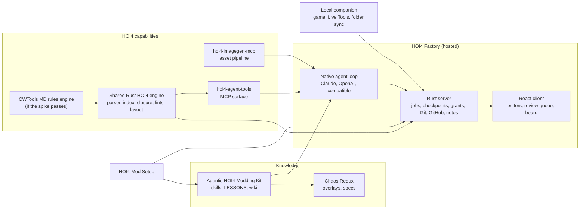

# Architecture proposal

Status: **Proposed for approval**. This document shows how the expansion fits the existing HOI4 Factory architecture without a second orchestration system, a second tracker or a second copy of HOI4 knowledge. It builds on the [recommended architecture](../02-architecture/recommended-architecture.md), the [contracts](../02-architecture/contracts-and-interfaces.md) and the decisions in the [decision record](00-decision-record.md). Items that still depend on an open decision are marked.

## Five separated layers

The request asks to keep five concerns apart. Each has one owner.

| Layer | What belongs here | Owner |
|---|---|---|
| Shared orchestration infrastructure | Jobs, attempts, leases, checkpoints, grants, budgets, review queue, decision history, Git, GitHub mirror, notifications | HOI4 Factory Rust server crates. Nothing HOI4-specific |
| HOI4-specific capabilities | Parsing, symbol index, reference closure, lints, layout solvers, renders, rewrites, asset pipeline | Shared Rust HOI4 engine (D-07), hoi4-agent-tools (MCP surface), `hoi4-imagegen-mcp` |
| Project-specific rules and workflows | A mod's conventions, catalog rules, naming, design style, test plans | The mod's own `CLAUDE.md` or `AGENTS.md`, notes and specs, for example Chaos Redux overlays (P10) |
| Deterministic validation | Every mechanical check, with tri-state results and coverage | Rust engine rules, called by the kit's `check.py`, by agent-tools and by HOI4 Factory |
| Creative and gameplay decisions | Story, design calls, balance intent, art direction | People and agents at checkpoints, recorded in specs and decision history. Tools arrange and check, they never invent content |

## Components and repositories

| Component | Responsibility | Language | Notes |
|---|---|---|---|
| Shared Rust HOI4 engine | Lossless parser with spans, symbol index, reference closure (P1), lints including generated vocabulary (P2), override audit (P3), findings baseline (P4), focus layout evaluation and placement (FR-3), harvested Hagane modules | Rust | Library plus command-line interface, in a Cargo workspace inside hoi4-agent-tools under Apache-2.0 (C1) |
| hoi4-agent-tools | MCP surface for agents, existing 28 tools. Tools move onto the engine one at a time behind the same names, until the TypeScript index is retired | TypeScript today, Rust over time | Existing tests become the regression suite for each move |
| `hoi4-imagegen-mcp` | HOI4 asset generation, editing, processing, validation and registration (FR-2) | Rust, forked from gptimage and rewritten (D-07, D-09) | MIT, public |
| Kit | Canonical generic HOI4 knowledge (skills, `LESSONS.md`, wiki snapshot), checks, runtime projections, upfront questions rule (FR-1), synchronization (FR-4) | Markdown and Python checks, calling the engine CLI | Single authoring home (P10) |
| Chaos Redux | Its own design rules, catalog and specs, plus overlays on generated kit skills | Mod content | Receives generated skills (P10) |
| HOI4 Mod Setup | Project creation and import, preservation, recovery, install of the kit | Rust | Gains the preservation report (P4) |
| HOI4 Factory server | Orchestration, checkpoints, grants and budgets, jobs, Git and GitHub, notes index, broker profiles for the engine, agent-tools and imagegen | Rust | New crates listed below |
| HOI4 Factory agent loop | Model-agnostic loop. Loads kit skills and lessons as versioned product knowledge (A4) and project instructions as labelled data | Rust | Provider adapters from S03 |
| HOI4 Factory client | Editors (focus first, own design track, two-way with agents through the same operations per FR-5), review queue, jobs board, notes, Git views, tours | React and TypeScript | Plain CSS, i18n, strict CSP |
| Local companion | Pairing with a project, game install discovery, mod folder sync, log upload, HOI4 Live Tools bridge for test cards | Rust | Optional (D-02). Full v1 scope (C4) |

## New HOI4 Factory server crates

| Crate | Owns | Contracts |
|---|---|---|
| `tasks` (S03, planned) | Jobs, attempts, leases, fencing, events, handoff records | C-03 |
| `broker` (S03, planned) | Grants, budgets, tool profiles for the engine, agent-tools and imagegen | C-04, C-08 |
| `checkpoints` | Checkpoint policy, checkpoints, decisions, review queue | Extends C-03 and C-08 |
| `board` | Board fields, labels, milestones, dependencies, ready-work queries, GitHub issue overlay | Extends C-03 and C-10 |
| `notes` | Notes index, link graph, retrieval for context bundles | Extends C-06 |
| `specs` | Spec items with stable IDs and origin tags, the P13 gap audit | Extends C-06 |
| `gitflow` | Save points, worktrees, staging, operation log, conflict detection, image diffs | Extends SPEC-005 |

## How a request flows through the system

1. A member opens a job on the board (or accepts an agent-proposed job). The job links spec items, notes and an autonomy level.
2. The agent loop builds a C-06 bundle: job, spec items, decision history, confirmed notes, relevant kit skills and lessons, and the project's own instructions as labelled data.
3. Intake consultation (FR-1) runs, answers become decisions and spec updates.
4. The agent calls HOI4 tools through the broker. Every call carries the job's grant and budget. Reads go to the engine and agent-tools, images to `hoi4-imagegen-mcp`.
5. Writes become source-bound proposals with expected hashes in the job's worktree. The engine re-validates them and reports the finding delta.
6. Checkpoints stop or notify according to the project's policy. Visual reviews show renders, diffs show semantic and raw changes, the finding delta and evidence rungs.
7. Commits, pull requests and merges go through Git and GitHub effects with intent, receipts and reconciliation.
8. Optional game verification runs through the local companion and returns user-operated evidence.

## Hosted and local differences

| Concern | Hosted HOI4 Factory | Local companion and local tools |
|---|---|---|
| Mod files | Server workspace with Git, the source of truth | Synced copy in the user's mod folder for playing. Local edits return as proposals, never as direct writes |
| Game files | Read-only server reference, never served raw (ADR-015) | The user's own installation, never uploaded |
| Running the game | Not possible on the server | HOI4 Live Tools on Windows, user-operated evidence |
| Logs | Uploaded only on the user's action ("Report a game problem") | Read locally from the user's game folder |
| Execution permissions | Broker grants, gVisor tool containers (ADR-020) | The companion acts only on paired projects and named folders, and asks before every write outside the mod folder |
| Network | Same-origin client, outbound policy for model endpoints | The companion connects outbound to the server. No inbound port. Pairing and origin rules are designed new, not copied from Hagane's loopback model |

## Cost as a design constraint

Hagane Works closed because hosting costs outran revenue. HOI4 Factory keeps per-user server cost visible and bounded: heavy work that needs the game runs locally, model and image use is metered against per-task and per-account budgets, the monthly allowance is the operator's only open-ended exposure, background model jobs (reflection, model-judged drift) are opt-in and capped, and self-hosting with the same images stays fully supported.

## What is deliberately not built

- No second task tracker. GitHub issues stay authoritative for linked jobs.
- No second copy of HOI4 knowledge in HOI4 Factory. The kit is the source.
- No second parser for validation. The engine is the one implementation, with CWTools rules as an input only if the spike passes (C2).
- No Drift Bot (B3).
- No separate focus tree MCP. Focus quality work goes into the engine and agent-tools.
- No hosted use of the ChatGPT login backend.
