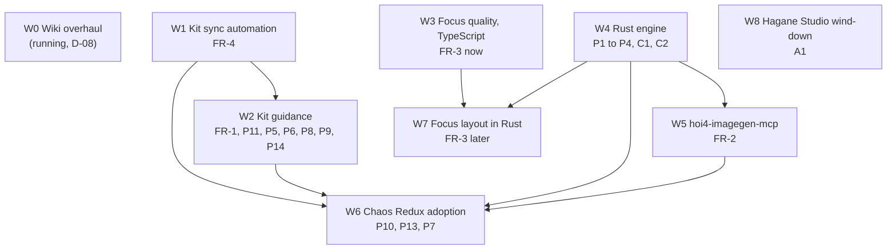

# Implementation roadmap

Status: **Approved by the maintainer on 2026-10-31** (Phase D). Following D-13, the first implementation covers research and workflow updates only: the kit, hoi4-agent-tools, the new `hoi4-imagegen-mcp`, HOI4 Mod Setup touch points and Chaos Redux workflow files. HOI4 Factory product features stay designs until their stage is authorized, and the mapping at the end shows where each one lands.

## Progress

| Package | State | Evidence |
|---|---|---|
| W0 | Merged into the kit's local `main` (`56f917f`), not pushed. The maintainer's follow-up answers (short file names without spaces, CC BY-SA 3.0 in `NOTICE` and the manifest, `[unverified]` in-game notes, the Chaos Redux drift check, Python 3.13 packages, the define tables moved to a kit page) are in progress on a kit branch from `56f917f`. Pushing `56f917f` with these follow-ups is approved once the checks pass | `verify_wiki_snapshot.py`: 63 pages, no problems |
| W1 | Committed on the kit's local `main` (`35fcffa`), not pushed. HOI4 Mod Setup pull request [#137](https://github.com/klimPaskov/HOI4-Mod-Setup/pull/137) open, CI pending | See [W1 evidence](#w1-evidence) |
| W2 | Committed on the kit's local `main` (`d7a8987`), not pushed. FR-1, P5, P6, P8, P9, P14 and a first P11 pass are done. Six skill rules that vanilla contradicts are corrected. D3 and D4 wording moves to W5, because no agent tool can operate a ComfyUI endpoint before the image server exists. Still open: slimming the largest skills, the focus rubric (with W3) and the image skill (with W5). The FR-1 check that needs a model run is unavailable | Kit `docs/development/guidance-audit-2026-10-31.md`, `LESSONS.md`. The contract, release, sync and quality checks pass |
| W3, W4 | Running in their own sessions, each in its own hoi4-agent-tools worktree | Reported by those sessions |
| W5 | In progress locally in `hoi4-imagegen-mcp`. Nothing in FR-2 needs the W4 engine, so the W4 edge is only an ordering preference. Creating the public repository and pushing wait for the maintainer's yes | None yet |
| W6 | Blocked: the Chaos Redux tree has 1,450 uncommitted changes, which the maintainer has to commit or set aside first. It also needs W2, W4 and W5 | None |
| W7 | Waits for W3 and W4 | None |
| W8 | Blocked: the maintainer's GitHub account has read access only to `hagane-works/hagane-studio`. It needs maintain or admin rights, or a transfer of the repository | `gh api` permissions on 2026-10-31 |

### W1 evidence

Each criterion is demonstrated by `.tools/tests/test_sync.py` in the kit (31 tests on fixture mods built from the shipped tools). They passed on Windows 11 with Python 3.13.5 and on a fresh Linux clone in `python:3.13-slim` (Python 3.13.18). The live hook command was also run on the kit itself.

| # | Criterion | Observed |
|---|---|---|
| 1 | Instruction edit updates or flags `AGENTS.md` | The hook command regenerated `AGENTS_template.md` after the template edit in 0.40 s and named it for the commit. `--check` reports `DRIFT`. A hand edit of `AGENTS.md` is refused with exit 2 and kept |
| 2 | Skill edit updates or flags its copies | Only the edited skill's copies change. A mod with `.codex/` fails the check without `.agents/skills`. A source-package mirror round-trips and detects a mutated file |
| 3 | Agent add, modify, remove | Codex TOML, `config.toml` row and maps are written, updated, flagged `STALE` and removed. The agent count comes from the folder. A malformed agent fails with exit 2 |
| 4 | No unnecessary work | Hook on mod content exits 0 with no output (0.27 s on Windows). A sentinel generator never starts for unrelated paths or for skill edits |
| 5 | CI detects stale projections | Every mutation fails `generators.py --check` and `check.py`'s generators check. CI now runs it unfiltered on pull requests, plus a Linux, macOS and Windows job. CI itself has not run yet because nothing is pushed |
| 6 | Setup and runtimes compatible | Registry outputs are inside Setup's rewritable allowlist (tests on both sides, Setup side in #137). `check.py setup` repairs a stale fixture mod and changes only allowed paths. On the fresh Linux clone it left the generators in sync. A real HOI4 Mod Setup install and update round trip was not run: it needs the desktop app pointed at the local kit commit (`HOI4_MOD_SETUP_SOURCE_REPOSITORY`) |
| 7 | Failures visible | Missing script, broken or missing registry, crashing generator, needs cycle and an empty folder each exit 2. `check.py setup` returns non-zero. The optional pre-commit hook blocked a stale commit on Linux |

Not yet verified: macOS, until the kit branch is pushed and CI runs. Maintainer actions: a ruleset that requires the Validate job on the kit's `main`.

## Order and dependencies

W1 comes first because every later kit change edits canonical files, and reliable projections protect all of them. W3 and W4 can run in parallel with W2 because they live in a different repository.

## Work packages

### W0 Wiki overhaul (running)

Repository: kit. Owner: the separate wiki session (D-08). Result: every page reviewed and updated against 1.19.3.0, missing pages added, local improvements preserved by the sync, a refresh workflow. Merged into the kit's local main by that session, not pushed.

### W1 Kit sync automation (FR-4)

Repository: kit, worked directly in the checkout.

| Change | Acceptance |
|---|---|
| `.tools/sync/generators.json` registry and a shared runner in `.tools/lib/` | Each FR-4 criterion demonstrated on Windows and macOS |
| One Claude Code `PostToolUse` hook, deny rules for generated paths | Editing a canonical file regenerates its outputs. Editing an output is refused |
| Tool fixes: `--root`, `--skill`, real skill mirror check, nonzero exit on failure, ported stale-replacement check | A broken generator fails visibly in `check.py`, Setup and CI |
| One unfiltered CI step, release gate, optional pre-commit hook (off by default), `.tools/py.sh` | CI fails on a stale projection. Release script checks the registry |
| HOI4 Mod Setup: shared test that keeps its allow-list and the registry in step | Setup install and update round trip on a fixture mod passes |

Maintainer action: add a ruleset that requires the Validate job on the kit's `main`.

### W2 Kit guidance (FR-1 and adopted Hagane ideas)

Repository: kit, directly in the checkout. Every change passes W1's checks and keeps all instructions (P11 constraint).

| Change | Source | Acceptance |
|---|---|---|
| "Upfront consultation" stub in the template plus `consultation-questions.md`, one-line skill pointers, `decisions.md` record | FR-1 | Template under its cap, sync and size checks pass |
| Template and skill slimming by deduplication and moves into references, with a diff audit proving no instruction was lost, and the MCP-unavailable contradiction resolved | P11 | The diff audit lists every moved rule and its new place |
| New small skill `hoi4-investigate` (static root-cause protocol, evidence ladder, premise tripwires, log reading order when a log is supplied, parser cascade rule) | P5, P6 | Under 8 KB. Debug-playtest points to it instead of restating |
| Confirmed traps added where missing, evidence tags on rules, `LESSONS.md` ledger | P8, P9 | Each trap cites its 1.19.3 evidence. Contradicted Hagane claims never appear |
| Feasibility check step in `hoi4-feature-planning` | P14 | One step, answered with reference tools and recorded beside the spec item |
| Focus skill workflow and rubric (with W3) | FR-3 | The slogan list is replaced by the rubric and the ten-step workflow |
| Image generation skill and profile rows (with W5) | FR-2 | Profiles for every category with vanilla evidence |
| Kit rule change for ComfyUI endpoints and vanilla reference opt-ins | D3, D4 | Wording in the asset skills, off by default |

### W3 Focus quality in hoi4-agent-tools, TypeScript part (FR-3 now)

Repository: hoi4-agent-tools, feature branch and pull request (pre-approved for this repository).

| Change | Acceptance |
|---|---|
| Layout metrics, verdict, scorecard and fix hints in `focus_inspect` and `focus_rewrite` | Metric unit tests with hand-computed values, invariance tests |
| Calibration file from the 67 vanilla 1.19.3.0 trees, recomputed when the game is present | Test fails when the stored calibration drifts from the game |
| Orthogonal in-game connector model, bundle-aware compact gate | The six real trees refused today are accepted or get a precise "nothing to improve" |
| Inline render images and per-branch crops | Agents receive images without an extra call |
| Clearer tool descriptions | Description text states the workflow and the verdict meaning |
| Supplied tree as a fixture once the maintainer agrees | Today's `ok` becomes `revise`, solver placement reaches `pass` |

### W4 Shared Rust HOI4 engine (P1 to P4, C1, C2)

Repository: hoi4-agent-tools, a Cargo workspace under Apache-2.0.

| Change | Acceptance |
|---|---|
| Lossless parser with spans, symbol index | Byte-identical round trip on vanilla and the maintainer's public mods |
| Reference closure with resolved, unresolved and unknown results and per-kind coverage (P1) | Chaos Redux B001 classes (unknown scripted triggers, undefined effect) are caught on a fixture. Unknown is never a pass |
| Lints with vocabulary generated from `documentation/` (P2) | Valid and invalid fixture per rule, zero false alarms on vanilla |
| Override and load-order audit (P3) | Fixture where a copied `00_on_actions.txt` drops hooks is reported |
| Findings baseline (P4) | Only new findings fail. The baseline count is shown and shrinks |
| Command-line interface used by `check.py`, MCP routes moved behind the same names one at a time | The existing agent-tools tests pass for every moved route |
| Harvested Hagane modules (span repair plan, finding delta, dead-flag and DLC lints, draw.io importer, finding codes as fixtures) | Provenance notes on every adapted file |
| CWTools MD Edition spike (C2) | Integrated only if it improves true findings with acceptable false positives, startup and memory on amd64 and arm64 |

### W5 hoi4-imagegen-mcp (FR-2)

Repository: new `klimPaskov/hoi4-imagegen-mcp`, created by forking `Connected-Mate/gptimage` (D-09), then rewritten in Rust.

| Change | Acceptance |
|---|---|
| Fork with MIT notices kept, `UPSTREAM.md` mapping | Attribution visible in LICENSE, NOTICE and README |
| Crates core, providers (OpenAI, Gemini, ComfyUI, fal), MCP, CLI, isolated ChatGPT-login plugin | Plugin never in default builds (CI check) |
| Thirteen `hoi4.image_*` tools, versioned outputs, ledger, install gate | Test layers L0 to L3 and L6 to L9 pass |
| Profiles from the kit's `profiles.json` with vanilla-measured canvases | Calibration diff against the game reported by `image_profiles` |
| HOI4 Mod Setup binary component, MCP entries, `hoi4-imagegen` skill, examples | Install round trip on Windows and macOS |
| Transition: retire vendored gptimage and dead provider routes once covered | No duplicate default provider remains |

Blocked parts: real-provider recordings (L4) and the in-game check (L5) need provider keys with balance and a user-operated game session.

### W6 Chaos Redux adoption

Repository: Chaos Redux, instruction, skill and tool files only. Starts after the maintainer has committed or set aside the current uncommitted edits in that tree.

| Change | Source |
|---|---|
| Adopt the kit's sync tools and registry, fix the stale Codex agent rows | FR-4, P10 |
| Engine-system skills generated from kit skills plus Chaos Redux overlays, backport audit for design skills | P10 |
| `chaos-redux-investigate` mirror | P5 |
| Stable spec item IDs and origin tags in new spec packages, handoffs cite them, gap audit | P13 |
| Test plan section in event docs | P7 |
| Engine CLI checks in `check.py` | P1 to P4 |

### W7 Focus layout in the Rust engine (FR-3 later)

Repository: hoi4-agent-tools. Solver layout per branch lane with `relative_position_id` anchors (D1), corridor insertion of new branches with untouched coordinates kept, shared geometry for renders and metrics, vanilla `offset` blocks. Acceptance: determinism across Windows, macOS and Linux, idempotent second call, untouched-focus hash unchanged, runtime far below today's 21 to 70 seconds.

### W8 Hagane Studio wind-down (A1)

Repository: `hagane-works/hagane-studio`, once the maintainer controls it. Final tagged release, a README banner pointing to HOI4 Factory, maintenance-only fixes. Archived when the archive conditions in the [Hagane Works analysis](03-hagane-works-analysis.md#hagane-studio-reuse) are met.

## HOI4 Factory mapping (designs, built only in authorized stages)

| Design | Planned stage | Depends on |
|---|---|---|
| Engine library linked into the server, reference closure before agent commits | S04 | W4 |
| Focus editor on `@xyflow/react` with the harvested Hagane shell, visual review checkpoint, layout verdict gating | S04, through the UI design track | W3, W4, W7 |
| Autonomy presets, checkpoints, review queue, decision history, intake consultation | S04 for the minimal checkpoint set, S05 for the full policy | S03 |
| Jobs board (simple version), notes, Git save points and review views, onboarding tours | S06 | S05 |
| Image adapter, assets screens, allowance with cheap-tier allowlist | S06 | W5 |
| Local companion full v1 | A new stage proposal after S06, with its own security review | Live Tools, W4 |
| Import preservation report and findings baseline in the Setup flow | S04 or S05 | W4, Setup |

Each stage packet is updated when the maintainer authorizes that stage. This plan does not change the stage files.

## Git and release considerations

- **Kit:** work happens directly in the checkout (D-13). Commits stay local until the maintainer approves a push, because the kit is not on the pre-approved list. Releases follow the kit's `RELEASING.md`, and the Setup manifest pin is refreshed after a release.
- **hoi4-agent-tools:** feature branches and pull requests are pre-approved. Merges happen only when the maintainer says so. npm releases carry the engine binary per platform. The Setup manifest pins the new version.
- **hoi4-imagegen-mcp:** creating the fork is an outward action that this plan's approval authorizes. Releases ship signed checksums for Windows x64, macOS arm64 and Linux amd64 and arm64.
- **HOI4 Mod Setup:** feature branches and pull requests are pre-approved. They cover the imagegen component, the registry test and the preservation report.
- **Chaos Redux:** local commits after the maintainer's own edits are settled. No push without approval.
- **HOI4 Factory:** this planning package is committed locally. The push waits for the maintainer, with a pull and rebase first, because S03 may be running on the Mac.
- **Disk:** every Rust build shares one `CARGO_TARGET_DIR` and checks free space first. The Windows disk has about 20 GB free.
